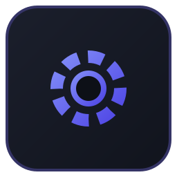

<p align="center">
  
</p>

<h1 align="center">Red Cogs V3</h1>

<p align="center">Experimental cogs (kudos & badtouch) for Red-DiscordBot v3.</p>

<p align="center">
  
  
  
</p>

---

Two experimental cogs for [Red-DiscordBot](https://github.com/Cog-Creators/Red-DiscordBot):

- `kudos` tracks positive points for server members and displays a top-ten ranking.
- `badtouch` tracks a separate point total and displays a top-five ranking.

Both cogs store member totals with Red's `Config` API.

## Status

This repository is an old test project, not a maintained cog collection. The code does not include the current Red cog metadata or setup hooks, so it is not ready for installation through Downloader without additional work.

## Source files

```text
kudos/kudos.py
badtouch/badtouch.py
```

## License

See [LICENSE](LICENSE).
